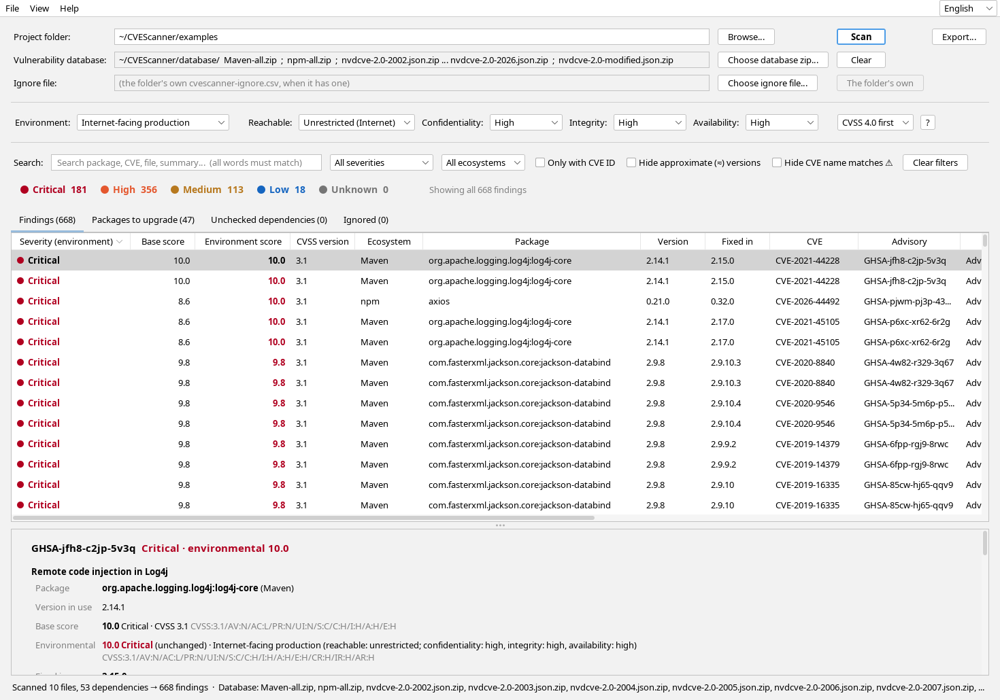
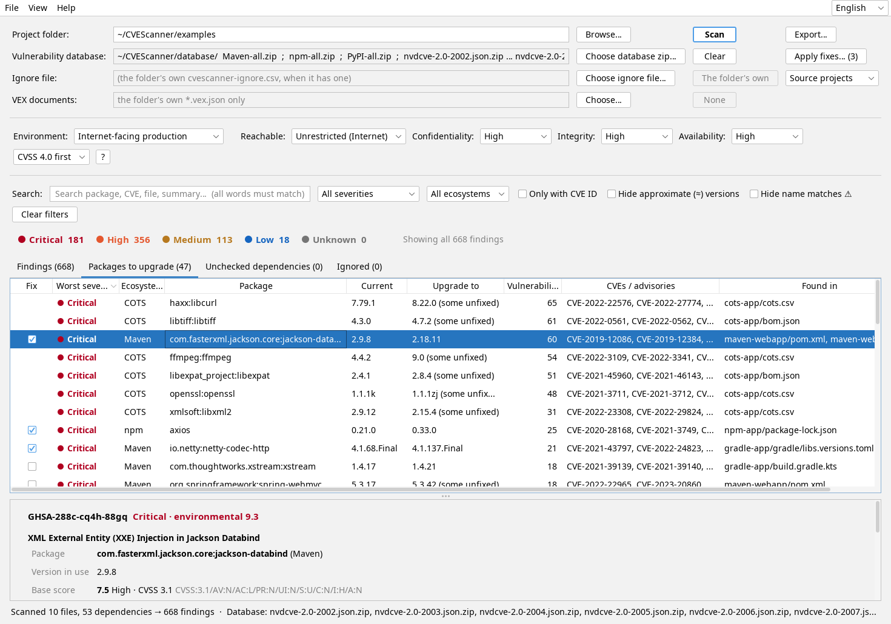
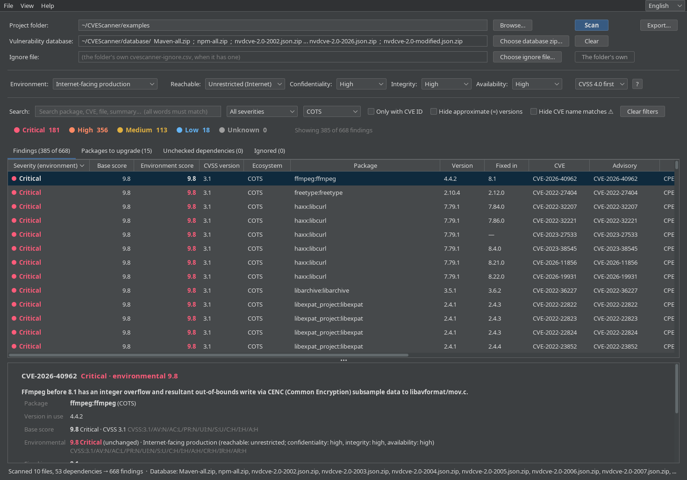

# CVEScanner

[](https://github.com/j4ckk0/CVEScanner/actions/workflows/build.yml)
[](LICENSE)


**Which known vulnerabilities apply to your projects and to the components they ship?** CVEScanner looks through a
folder for every `pom.xml`, Gradle build file and `package.json`, and reads the dependencies they declare (and, with
a lockfile, the npm ones they pull in). It also finds the **components off-the-shelf** — GDAL, FFmpeg, OpenSSL,
zlib, curl, SQLite… — that a component inventory, an SBOM, a C/C++ build manifest (pkg-config, vcpkg, Conan) or the
binaries themselves name. It checks each against vulnerability databases you downloaded as zip files: the GitHub
Advisory Database, the CVE List, OSV.dev's exports, NVD's CVE feeds. The findings are shown in a table you can
filter, search and sort, and written as reports (`report.md`, `findings.csv`, `findings.json`). Each finding comes
with **its severity** (critical, high, medium, low), **its CVSS base score** (3.x or 4.0) and **its environmental
score**: the score for where the software runs — internet-facing, internal network, air-gapped, developer
workstation, or values of your own — which can lower or raise the severity.

It is a desktop program with a command line for CI, made for computers without internet access: it runs on its own —
each distribution carries its Java runtime — and it **never reaches the network** (see [No network](#no-network)). It
speaks French and English.

[**Download the latest release**](https://github.com/j4ckk0/CVEScanner/releases/latest) for Windows or Linux — nothing
to install, a Java runtime is inside: unpack it anywhere, drop a database zip into its `database` folder, and start
`CVEScanner.exe` or `cvescanner.bat` (Windows), `cvescanner.sh` (Linux). Its `examples` folder is there to scan first.



| | |
|---|---|
| You scan projects | [**The databases**](#the-databases), then [**The window**](#the-window) or [**The command line**](#the-command-line) |
| You ship native components | [**Components off-the-shelf**](#components-off-the-shelf): GDAL, FFmpeg, OpenSSL… from an inventory, an SBOM, a build manifest, the binaries |
| You review the findings | [**Ignoring findings**](#ignoring-findings): those reviewed and accepted set aside in `cvescanner-ignore.csv`, why and until when |
| You read the results | [**Understanding the results**](#understanding-the-results) and [**CVSS scores and environments**](#cvss-scores-and-environments) |
| You want it on your machine | [**Build and run**](#build-and-run) and [**Packaging**](#packaging): self-contained archives for Windows and Linux |
| You read or change the code | [**Layout**](#layout) |
| Your security team asks | [**No network**](#no-network) |

## No network

The program reads the folder it scans and the database zips it is given, and writes its reports and its settings
beside it — and the ignore file, when you ask the window to ignore a finding; that is all. No download, no update
check, no browser, no file manager, no other program started: a link is copied to the clipboard, to open elsewhere,
and after an export the folder's path is offered to copy.

**No name lookup either, not even the JDK's own**: `NoNetworkResolver` takes the place of Java's name service and
answers every lookup as an unknown host. **A scanned project or a database cannot make it reach the network**: the
`pom.xml` parser refuses DTDs, external entities and XInclude; what a database writes (an advisory's summary, its
details, its links) is shown as text, never as HTML a window would fetch an image or a style sheet from, and only
`https://` links are kept, to copy. `NoNetworkTest` reads every class of the program and of FlatLaf, the one library
shipped, for what reaches the network, at every build; `HostileAdvisoryTest` and `PomParserTest` try the rest.

## The databases

Download one or more of these files on a computer with internet access, and give them to CVEScanner **without
extracting them**: drop them in the `database` folder beside the program (loaded at each start), or choose them in the
window, or name them with `--db`.

| Database | Download | Matches |
|---|---|---|
| GitHub Advisory Database (recommended) | <https://github.com/github/advisory-database/archive/refs/heads/main.zip> (`advisory-database-main.zip`, the same as *Code → Download ZIP*) | the exact Maven/npm package and its affected versions, with the CVE IDs |
| CVE List, the CVE Program's official list (optional) | <https://github.com/CVEProject/cvelistV5/releases>: the newest release's asset `YYYY-MM-DD_all_CVEs_at_midnight.zip.zip` (about 500 MB, a zip in a zip); not the `_delta_` files | exact when the record names the package (**CVE record**); otherwise by product name, marked **CVE name match ⚠**, to check; some CVEs cannot be tied to a package at all (Log4Shell's record) |
| OSV.dev exports (optional) | `https://osv-vulnerabilities.storage.googleapis.com/Maven/all.zip` and `…/npm/all.zip` | as the GitHub Advisory Database |
| NVD CVE feeds, for components off-the-shelf | `https://nvd.nist.gov/feeds/json/cve/2.0/nvdcve-2.0-YYYY.json.zip`, one per year from 2002 (about 25 MB each), and `nvdcve-2.0-modified.json.zip` | GDAL, FFmpeg, OpenSSL… by their CPE: vendor, product and version ranges (see [Components off-the-shelf](#components-off-the-shelf)) |

When several are loaded, a CVE already covered by an advisory is reported once. To update, download fresh files and
delete the old ones; each report says which files, of which date, it used.

## Components off-the-shelf

Besides Maven, Gradle and npm packages, CVEScanner checks the **components off-the-shelf** (COTS) a project ships:
native libraries and programs such as GDAL, FFmpeg, OpenSSL, zlib, curl, SQLite. They have no package coordinates;
NVD files their CVEs by vendor and product (a CPE, `cpe:2.3:a:osgeo:gdal:…`) with version ranges, and CVEScanner
matches them against **NVD's CVE feeds** and the CVE List. It finds them four ways:

| Where | What it reads |
|---|---|
| **An inventory**, `cots.csv` (or `*.cots.csv`) | one line each, `name,version[,vendor][,cpe]`: `GDAL,3.4.1`; `libfoo,1.2,acme`; `x,,,cpe:2.3:a:osgeo:gdal:3.4.1:*:*:*:*:*:*:*` |
| **An SBOM**: CycloneDX (`bom.json`, `*.cdx.json`) or SPDX (`*.spdx.json`) | its components: by CPE, or by name; one with a Maven or npm package URL is checked as a Maven or npm package |
| **A C/C++ build manifest** | pkg-config `*.pc` (`Name:`, `Version:`); `vcpkg.json` (an override's version, or the `version>=` minimum, ≈); Conan's `conanfile.txt`, `conanfile.py`, `conan.lock` |
| **A binary** | a Windows DLL or EXE's version resource (ProductName, ProductVersion), read without loading it; otherwise its file name, its version only when spelled out (`ffmpeg-4.4.2.exe`, ≈) |

A name CVEScanner knows (GDAL, FFmpeg and its libraries, OpenSSL, zlib, curl, SQLite, libxml2, libpng, libtiff,
libjpeg-turbo, expat, Poppler, ImageMagick, Boost, Qt, libwebp, FreeType, libarchive, OpenJPEG, HDF5, NetCDF, PCRE2,
nghttp2, libssh2, protobuf, glibc, VLC, LibRaw, JasPer) gives the vendor:product NVD uses: a match by both is a
**CPE match**. Any other name is matched by product alone, a **CPE product match ⚠** to check; give its vendor or its
CPE in the inventory to make it exact. Limits: a binary's ABI number (`avcodec-58.dll`, `libgdal.so.30`) is not the
product's version, so such a binary is unchecked; a CVE NVD says affects a component only on some platform is
reported as affecting it; a range NVD bounds by dates (FFmpeg's git snapshots) is not compared with a release number.
`examples/cots-app` shows all four, with what a scan of NVD's real feeds finds in it.

## The window

Start `cvescanner.bat` or `CVEScanner.exe` (Windows), `cvescanner.sh` (Linux); give it a folder to scan it at once.

1. **Project folder**: the folder of your project(s), its sub-folders scanned too.
2. **Vulnerability database**: the zips of `database/` are already there; *Choose database zip…* for others.
3. **Environment** (optional): where the scanned software runs, for the environmental score; changing it re-scores
   at once, without scanning again.
4. **Scan.** Reading a database takes from a few seconds to a minute or two, as its size.

To see it at work first, scan the `examples` folder beside the program: a Maven, a Gradle, an npm and a yarn project
declaring real packages at vulnerable versions (Log4Shell, Text4Shell, Spring4Shell…), what a scan finds listed in
[examples/README.md](examples/README.md).

The table sorts by any column and filters as you type: **Search** (every word must match, across the columns and the
aliases; Ctrl+F, Esc to clear), the **severity** (the coloured counters do the same), the **ecosystem**, *Only with
CVE ID*, *Hide approximate (≈) versions*, *Hide CVE name matches ⚠*. Its tabs: **Findings**, one row per
vulnerability and dependency, its details below (the fix, the scores, the match, the links); **Packages to
upgrade**, one row per package version with the version that fixes all its findings; **Unchecked dependencies**,
those whose version could not be known (an external BOM, a dynamic version like `1.+`), and why; **Ignored**, the
findings the ignore file sets aside (see [Ignoring findings](#ignoring-findings)). A double-click or a right-click
copies the advisory's link, the CVEs, the package's coordinates; a right-click also ignores a finding. **Export…**
writes the three reports for the rows shown. *View ▸ Look* offers FlatLaf's looks, light and dark; the language is
on the right of the menus. The choices are kept in `cvescanner.properties`, beside the program.





## The command line

```
cvescanner.sh --no-gui -d /src/my-app --env airgapped --fail-on HIGH      (Linux)
cvescanner-cli.bat --no-gui -d C:\src\my-app --fail-on HIGH               (Windows)
```

| Option | |
|---|---|
| `-d DIR` | the folder to scan |
| `-o DIR` | the reports' folder (the launchers: `reports/` beside the program) |
| `--db FILE`, `--db-dir DIR` | a database zip (repeatable), every zip of a folder (the launchers: `database/`) |
| `--cve-only` | only the vulnerabilities that have a CVE ID |
| `--env PRESET` | `none` (default), `internet`, `internal`, `airgapped`, `devci` |
| `--reach R`, `--cr/--ir/--ar V` | the reach (`internet`, `internal`, `local`), the security requirements (`L`, `M`, `H`, `X`) |
| `--cvss 4\|3` | the CVSS version preferred when an advisory has both (default 4) |
| `--lang fr\|en` | the messages' and `report.md`'s language (default: the window's, else French) |
| `--fail-on LEVEL` | exit code 2 when a finding is at or above `LOW`, `MEDIUM`, `HIGH` or `CRITICAL` |
| `--ignore FILE`, `--no-ignore` | the ignore file to read (default: the folder's `cvescanner-ignore.csv`, if any); none |

Exit codes: `0`, `1` on an error, `2` past `--fail-on`. Without a display the program goes to the command line by itself.

## Ignoring findings

A finding reviewed — the vulnerable code is not reachable, a setting turns it off, the risk is accepted until the next
release — can be set aside: it leaves the table, the counters, `findings.csv` and `--fail-on`, and is listed apart,
with its reason, in the **Ignored** tab and in a section of `report.md` and `findings.json`. The entries are in
`cvescanner-ignore.csv` at the root of the folder scanned, to keep and version with the project like a `.gitignore`:

```
# id,package,version,until,reason
CVE-2021-44228,org.apache.logging.log4j:log4j-core,2.14.1,2027-06-30,"Not exposed: JNDI lookups disabled, see SEC-12"
GHSA-jfh8-c2jp-5v3q,,,,Test scope only
CVE-2023-1234,osgeo:gdal,,,Driver not built
```

- **id**: an advisory (`GHSA-…`), a CVE or an alias, whatever the case. A CVE sets aside every advisory naming it,
  whichever database the scan reads.
- **package** (empty: any): the package as CVEScanner shows it — `group:artifact`, an npm name, a component's
  `vendor:product`.
- **version** (empty: any): that version only; an upgrade to another vulnerable version shows the finding again.
- **until** (empty: for ever): the last day the entry applies, `yyyy-MM-dd`; past it the finding is reported again
  and the scan says so.
- **reason**: why, for whoever reads the file next. A reason holding a comma is quoted, as a spreadsheet writes it.

In the window, right-click a finding, **Ignore this finding…**: for this version, every version of the package or every
package; a reason; a last day if any. The entry is written to the file (created the first time) and the table changes
at once, without scanning again; in the **Ignored** tab, **Stop ignoring** takes the entry's line out, the file's other
lines and comments kept as written. *Ignore file* above the table names another file, for every folder scanned.

On the command line `--ignore FILE` names another file, `--no-ignore` reads none (every finding reported, for an
audit). The scan warns of a line it cannot read, of an entry past its date, and of one that sets none of the
findings aside (it names none, or a line above sets them aside first) — an entry to clean up.

## Understanding the results

- **Severity** is the environmental severity when an environment applies and the advisory has a CVSS vector,
  otherwise the base one; the filters, the counters, *Packages to upgrade*, the reports and `--fail-on` all use it.
- **Fixed in**: the first version without the vulnerability (— when no fix is published).
- **≈ version**: an npm project without a lockfile is checked at the *lowest* version its range allows (`^4.17.0` →
  `4.17.0`); the version installed may be newer. Commit a lockfile for exact results.
- **Maven and Gradle** results cover the **declared** dependencies (and `dependencyManagement`); their transitive
  ones are only known to the build tool: run `mvn dependency:tree`, or enable Gradle's dependency locking.
- A finding means the version is in an advisory's affected range; whether the vulnerable code is used by your
  application still needs a human eye.

## CVSS scores and environments

For every finding with a CVSS vector, CVSS 3.0, 3.1 or 4.0, CVEScanner computes its **base score** and its
**environmental score**: the same vector with the environment's metrics. CVSS defines no list of environments; the
presets fill in its metrics, to adjust freely:

| Setting | CVSS metric | Effect |
|---|---|---|
| **Reachable** | Modified Attack Vector (MAV) | *Internal network only*: network attacks count as adjacent; *Local access only*: network and adjacent ones as local |
| **Confidentiality / Integrity / Availability** | Security Requirements CR / IR / AR | how much a breach of each would hurt the system; *Not defined* is CVSS's default (neutral in 3.x, high in 4.0) |

| Preset | Reachable | C | I | A |
|---|---|---|---|---|
| Not applied (base score) | — | — | — | — |
| Internet-facing production | unrestricted | High | High | High |
| Internal network service | internal | Medium | Medium | Medium |
| Air-gapped / offline system | local | Medium | Medium | Medium |
| Developer workstation / CI only | internal | Medium | High | Low |

An advisory with a rating and no vector keeps its rating. Example: Log4Shell, CVSS 4.0 base 10.0, scores 8.8 on an
air-gapped system. The CVSS 4.0 scoring is ported from the FIRST/Red Hat reference calculator (BSD 2-Clause, see
NOTICE).

## Languages

Every text a user reads is in a `messages_<code>.properties` file of its module, one per language, the same keys in
each: the scan's in `cvescanner-core/…/i18n/texts/`, the window's in `cvescanner-app/…/texts/`. `I18n` finds each
module's as a service (`I18nTexts`); what a scan finds and says later is kept as a `Phrase`, said in the language in
use. The window, the command line and `report.md` speak the language chosen; **`findings.csv` and `findings.json` are
always in English**, their readers being programs. Each module's tests check its texts (`TextsCheck`): the same keys in
each language, none blank, none unused.

## Build and run

Nothing to install: `scripts/setup.sh` deploys the JDK and Maven the scripts use (see "Externals").

```bash
scripts/setup.sh    # once: deploys the externals (JDK, Maven) into external/
scripts/run.sh      # builds cvescanner-app/target/cvescanner.jar if needed, then starts the program
scripts\setup.bat, scripts\run.bat    # same, on Windows
```

| Script | What it does |
|---|---|
| `scripts/setup.sh` / `.bat` | deploys the externals; `--force` downloads and deploys everything again |
| `scripts/build.sh` / `.bat` | builds the jar and runs the tests; what follows goes to Maven (`-DskipTests`) |
| `scripts/run.sh` / `.bat` | builds the jar if a source is newer, then runs it; `--rebuild` forces the build, the other arguments go to the program |
| `scripts/package.sh` / `.bat` | builds the distribution into `releases/` (see "Packaging") |
| `scripts/ci.sh` | a clean build with every test, run by `.githooks/pre-push` |
| `scripts/release.sh` | by hand, the GitHub release of a pushed tag (the release workflow does it on its own, see PUBLISHING.md) |
| `scripts/cvss-reference.py` | writes the CVSS scores `CvssReferenceTest` expects, with Red Hat's Python library `cvss` (used at development time only, never shipped) |

Every script uses the externals of `external/` and nothing installed on the machine. The version lives in `pom.xml`,
once, as `<revision>`. The pre-push hook is enabled once per clone with `git config core.hooksPath .githooks`.

## Externals

The software the build and the distributions need is not under source control. `externals.conf` names each one and its
version, and `scripts/setup.sh` deploys them under generic names into `external/`: `jdk` and `maven`. The
distributions' runtime is linked from that JDK. To fetch from a local mirror, set `MIRROR` in `externals.conf`, its
credentials in `externals.local.conf` (not under source control) or in the environment.

## Packaging

Each system builds its own self-contained distribution into `releases/`: `scripts/package.sh` on Linux,
`scripts\package.bat` on Windows. A release builds both, on GitHub.

| Archive | Built by | Holds |
|---|---|---|
| `cvescanner-<version>-linux.tar.gz` | `scripts/package.sh` | `cvescanner.sh` |
| `cvescanner-<version>-windows.zip` | `scripts\package.bat` | `cvescanner.bat` (the signed `javaw.exe`, no console), `CVEScanner.exe` (not signed), `cvescanner-cli.bat` (the command line) |

Each holds `cvescanner.jar`, its runtime `jre/` — linked by `jlink` from the JDK that builds: the program's two
modules, FlatLaf, the JDK's modules they need, the French and English locale data —, the `database/` folder, `LICENSE`,
`NOTICE`, FlatLaf's licence in `licenses/`, the `examples/` projects, and Java's AOT cache of the program, `cvescanner.aot`, for a faster start:
the build makes it by running the program once on the samples (it needs a display, or `xvfb-run` on Linux); should that
fail, the archive goes without it, with a warning.

## Publishing

The licence, and how a version becomes a release on GitHub (a pushed tag `vX.Y`): [PUBLISHING.md](PUBLISHING.md);
what each version brought: [CHANGELOG.md](CHANGELOG.md). CVEScanner is not published on Maven Central.

## Layout

Two Maven modules, each a jar and a Java module, built in this order by the parent `pom.xml`:

| Module | Jar, Java module | What it is |
|---|---|---|
| `cvescanner-core/` | `cvescanner-core`, `org.jtools.cvescanner.core` | the scan, with no window; the JDK alone (`java.xml`) |
| `cvescanner-app/` | `cvescanner`, `org.jtools.cvescanner` | the program: its window, its looks (FlatLaf), its distributions (`-Pdist`) |

| Path | What it holds |
|---|---|
| `cvescanner-core/…/project/` | the projects' dependencies: `ProjectFiles` (the files found), `MavenReader` (POMs, their properties and parents), `GradleReader` (build files, catalogs), `NpmReader` (package.json and its lockfiles), `DependencyCollector` |
| `cvescanner-core/…/db/` | the databases: `VulnDb` (the zips streamed, nested ones followed, only what the projects use kept), `Osv` (OSV records, their ranges), `CveList` (CVE JSON 5 records, their package and name matches), `NvdFeed` (NVD's feeds, read a record at a time: CPE rules) |
| `cvescanner-core/…/cots/` | components off-the-shelf: `InventoryReader` (cots.csv), `SbomReader` (CycloneDX, SPDX), `ManifestReader` (pkg-config, vcpkg, Conan), `BinaryReader` and `PeVersionInfo` (a DLL's version resource, read in bounded reads), `KnownProducts` (names to vendor:product) |
| `cvescanner-core/…/engine/` | `Engine` (a scan: files, dependencies, databases, matches) |
| `cvescanner-core/…/cvss/` | `Cvss` (vectors, the 3.x formulas, the 4.0 macrovectors), `Severity`, `Environment`, `Reach`, `Requirement`, `Rating`, `Score` |
| `cvescanner-core/…/model/` | what a scan finds: `Finding`, `Dependency` (its `Ecosystem`: Maven, npm, COTS), `Unresolved`, `PackageSummary`, `ScanResult`, `MatchBasis`; `Scoring` (a finding scored for an environment), `ScanListener` (a scan's progress) |
| `cvescanner-core/…/report/`, `…/cli/` | `Reports` (report.md, findings.csv, findings.json, the packages to upgrade); `Options` and `Cli` (the command line) |
| `cvescanner-core/…/json/`, `…/version/`, `…/i18n/` | `Json` (a small parser and writer), `JsonStream` (a large array's elements one at a time); `Versions` (Maven's and npm's version order); the languages: `I18n`, `I18nLanguage`, `I18nTexts`, `Phrase` |
| `cvescanner-app/…/` | `Launcher` (the entry point), `MainWindow`, `FindingDetails` (a finding's page, escaped), the table's `Column`, `ListTableModel` and renderers, `Settings`, `Looks`, `HelpMenu`, `I18nLabels` and `I18nLanguageBox`, `NoNetworkResolver` |
| `cvescanner-app/src/dist/`, `…/src/assembly/` | the distributions' launchers, the `database/` folder, FlatLaf's licence, and what goes in each archive |
| `*/src/test/` | core: `GoldenTest` (the samples' reports, case by case), `FrenchReportTest`, `CvssReferenceTest` (9,000 vectors scored by another implementation), `HostileReportTest`, the rules' unit tests, `PomParserTest`, `CoreTextsTest`; app: `NoNetworkTest`, `NoNetworkResolverTest`, `HostileAdvisoryTest`, `AppTextsTest` |
| `examples/` | Maven, Gradle, npm and yarn projects declaring real packages at vulnerable versions, to scan with a real database; in the distributions too |
| `samples/` | sample projects and made-up databases, and `make_fixtures.py`, which writes them; for the tests |
| `.github/workflows/` | `build.yml`, the build and the tests on every push; `release.yml`, the release on a tag `vX.Y` |

## Licence

Apache License 2.0 — see [LICENSE](LICENSE); [NOTICE](NOTICE) records the third-party terms: the CVSS v4.0 calculator
(BSD 2-Clause), FlatLaf, the Java runtime, and those of the databases you download.
