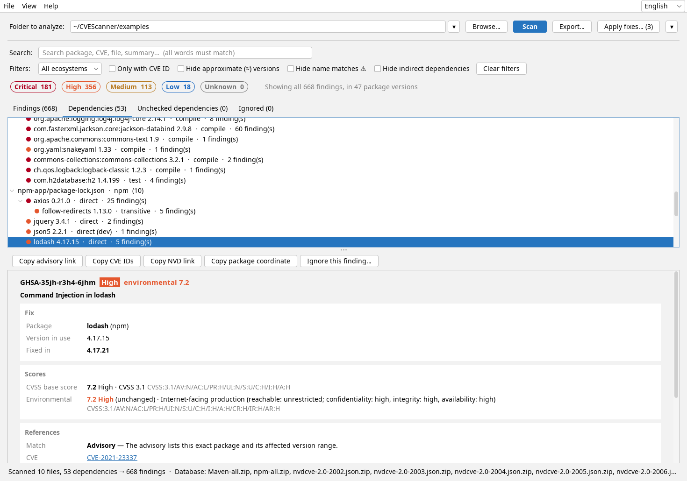
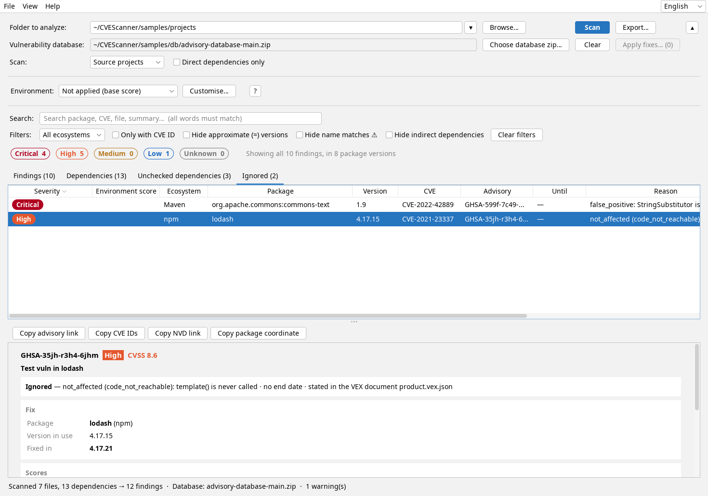
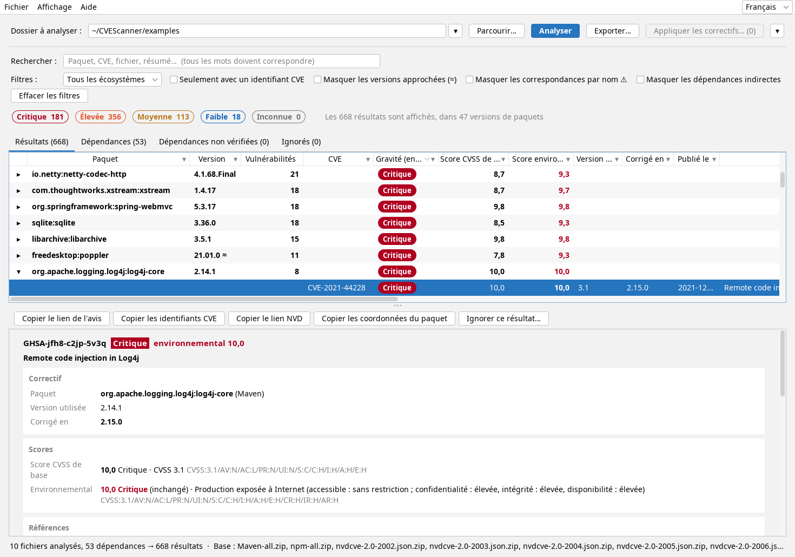
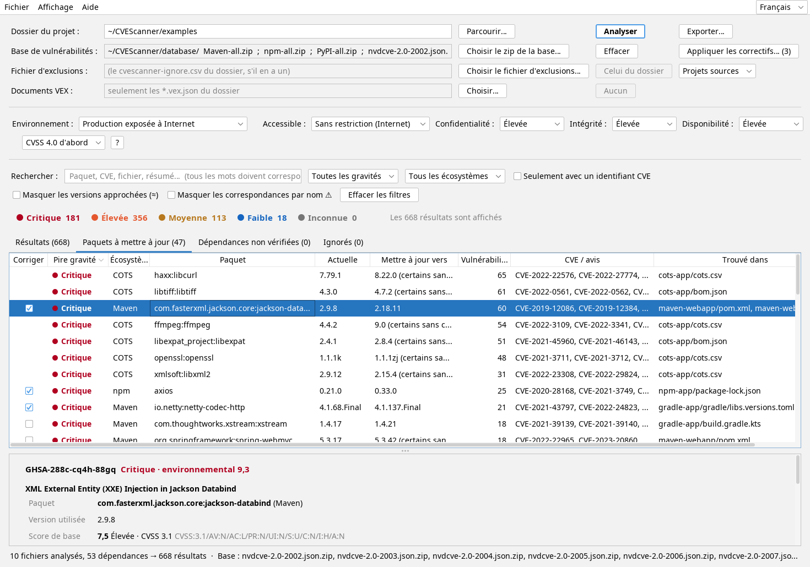
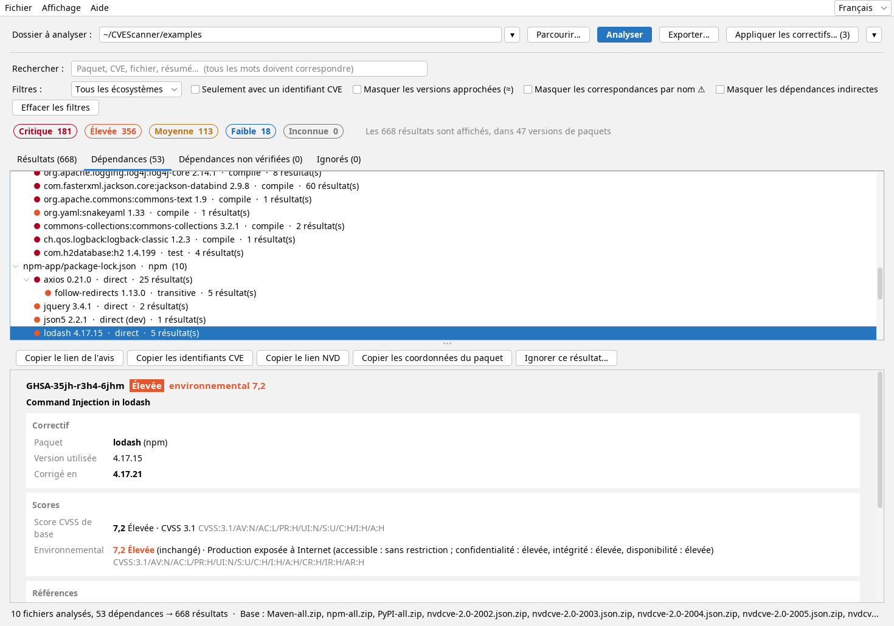
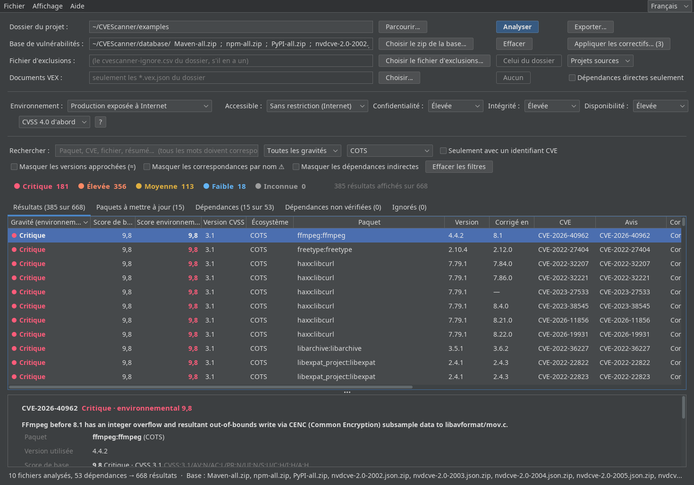
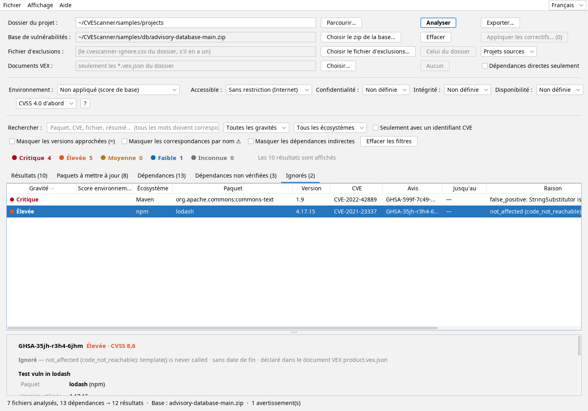

# CVEScanner

[](https://github.com/j4ckk0/CVEScanner/actions/workflows/build.yml)
[](LICENSE)


**Which known vulnerabilities apply to your projects and to the components they ship?**

## What it does

- **Finds the known vulnerabilities** (CVEs and advisories) of your **Maven, Gradle, npm/Yarn and Python** projects'
  dependencies, of the **native components you ship** (GDAL, FFmpeg, OpenSSL, zlib, curl, SQLite…), and of an
  **installed product** read from its binaries: the jars inside its fat jars, WARs and EARs, its `node_modules`, its
  Python packages, its native libraries.
- **Gives each finding its severity** (critical, high, medium, low), **its CVSS base score** (3.x or 4.0) and **its
  environmental score**: the score for where your software runs (internet-facing, internal network, air-gapped,
  developer workstation, or values of your own), which can lower or raise the severity.
- **Tells you which version fixes it**, and lists the packages to upgrade and to which version.
- **Applies the upgrades you tick**, each with the project's own build tool (Maven, Gradle, npm, yarn, pnpm), offline,
  and only those the project can take: none needing a newer Java or Node than the project targets.
- **Sets aside the findings you have reviewed**, with a reason and, if you want, an end date, in a file you keep with
  the project, and those a **VEX document** (CycloneDX) states do not apply.
- **Shows the findings in a table** you can filter, search and sort, and **writes them as reports**: `report.md` to
  read, `findings.csv` and `findings.json` for other tools, and `bom.cdx.json`, a **CycloneDX SBOM** of every
  dependency and its vulnerabilities. On the command line, a CI build can fail past a severity.
- **Says when a database is old**: it reads the date of its newest record, and warns past a month.
- **Works offline**: a desktop program with a command line, made for computers without internet access, that **never
  reaches the network**. In French and English.

[**Download the latest release**](https://github.com/j4ckk0/CVEScanner/releases/latest) for Windows or Linux — nothing
to install, a Java runtime is inside: unpack it anywhere, drop a database zip into its `database` folder, and start
`CVEScanner.exe` or `cvescanner.bat` (Windows), `cvescanner.sh` (Linux). Its `examples` folder is there to scan first.


## How it works

1. **It finds your dependencies** in the folder you give it, sub-folders included:
   - `pom.xml` files, with their properties and parents; Gradle build files, version catalogs and lockfiles; `package.json`
     files, with their lockfile (`package-lock.json`, `yarn.lock`, `pnpm-lock.yaml`) for the npm packages they pull in;
     Python's `requirements*.txt`, `pyproject.toml` (PEP 621, Poetry) and `Pipfile`, with their lockfile (`poetry.lock`,
     `uv.lock`, `Pipfile.lock`), whose versions win: a pinned version is exact, a range checked at its lowest (≈);
   - the native components named by a component inventory (`cots.csv`), an SBOM (CycloneDX, SPDX), a C/C++ build
     manifest (pkg-config, vcpkg, Conan), or the binaries themselves (a DLL's version resource, a file name).
   - or, for an **installed product** (*Installed product*, `--installed`), what it ships: each jar's Maven
     coordinates, the jars inside fat jars, WARs and EARs, each installed npm package's `package.json`, each Python
     package's `METADATA`, the version strings native libraries hold, the name of a jar without coordinates (see
     [Installed products](#installed-products)).
2. **It checks them against vulnerability databases you download** as zip files: the GitHub Advisory Database, the
   CVE List, OSV.dev's exports and NVD's CVE feeds. Nothing is fetched. Advisories match packages exactly; NVD matches
   components by vendor and product (CPE); the CVE List matches by package or by name.
3. **It scores each finding** from its advisory's CVSS vector (3.x or 4.0), or its rating when it has no vector, then
   applies the environment you chose as CVSS environmental metrics.
4. **It applies the fixes you confirm** with the project's own build tool, in its offline mode: `mvn versions:…`,
   `npm install`, `yarn add`, `pnpm add`, or the Gradle file edited then checked by Gradle. A tool not installed is
   not installed for you: that fix is simply not applied.
5. **It runs on its own**: each archive carries its Java runtime, and the program makes no download, no name lookup and
   starts no browser; the build tools it starts for a fix run offline (see [No network](#no-network)).

## Find your way

| | |
|---|---|
| You scan projects | [**The databases**](#the-databases), then [**The window**](#the-window) or [**The command line**](#the-command-line) |
| You ship native components | [**Components off-the-shelf**](#components-off-the-shelf): GDAL, FFmpeg, OpenSSL… from an inventory, an SBOM, a build manifest, the binaries |
| You run a product | [**Installed products**](#installed-products): what an installation ships, read from its jars, `node_modules`, `site-packages`, native libraries |
| You fix them | [**Applying fixes**](#applying-fixes): tick the packages to upgrade, the project's own build tool does it, offline |
| You review the findings | [**Ignoring findings**](#ignoring-findings): those reviewed and accepted set aside in `cvescanner-ignore.csv`, why and until when |
| You read the results | [**Understanding the results**](#understanding-the-results) and [**CVSS scores and environments**](#cvss-scores-and-environments) |
| You want it on your machine | [**Build and run**](#build-and-run) and [**Packaging**](#packaging): self-contained archives for Windows and Linux |
| You read or change the code | [**Layout**](#layout) |
| Your security team asks | [**No network**](#no-network) |

## No network

The program reads the folder it scans, the database zips it is given and, for the transitive dependencies of Maven and
Gradle projects, the poms of the local Maven repository (`~/.m2`) and of Gradle's cache (`~/.gradle/caches`;
`--direct-only` or the toolbar's *Direct dependencies only* turns both off); it writes its reports, and beside it its
settings and its `cache/` folder (the databases' index kept between scans; `--no-cache` reads the zips every time) — and the ignore file, when you ask the window to
ignore a finding; that is all. No download, no update
check, no browser, no file manager: a link is copied to the clipboard, to open elsewhere, and after an export the
folder's path is offered to copy. **The one program it starts** is the scanned project's own build tool, when you
click Apply fixes and confirm the commands shown, and only in its offline mode (`mvn -o`, `--offline`,
`npm_config_offline`); a version not already in the machine's caches is then not applied (see [Applying
fixes](#applying-fixes)).

**No name lookup either, not even the JDK's own**: `NoNetworkResolver` takes the place of Java's name service and
answers every lookup as an unknown host. **A scanned project or a database cannot make it reach the network**: the
`pom.xml` parser refuses DTDs, external entities and XInclude; what a database writes (an advisory's summary, its
details, its links) is shown as text, never as HTML a window would fetch an image or a style sheet from, and only
`https://` links are kept, to copy. `NoNetworkTest` reads every class of the program and of FlatLaf, the one library
shipped, for what reaches the network, at every build; `HostileAdvisoryTest` and `PomParserTest` try the rest.

## The databases

Download one or more of these files on a computer with internet access, and give them to CVEScanner **without
extracting them**: drop them in the `database` folder beside the program (loaded at each start), or choose them in the
window, or name them with `--db`.

| Database | Download | Matches |
|---|---|---|
| GitHub Advisory Database (recommended) | <https://github.com/github/advisory-database/archive/refs/heads/main.zip> (`advisory-database-main.zip`, the same as *Code → Download ZIP*) | the exact Maven/npm package and its affected versions, with the CVE IDs |
| CVE List, the CVE Program's official list (optional) | <https://github.com/CVEProject/cvelistV5/releases>: the newest release's asset `YYYY-MM-DD_all_CVEs_at_midnight.zip.zip` (about 500 MB, a zip in a zip); not the `_delta_` files | exact when the record names the package (**CVE record**); otherwise by product name, marked **CVE name match ⚠**, to check; some CVEs cannot be tied to a package at all (Log4Shell's record) |
| OSV.dev exports (optional) | `https://osv-vulnerabilities.storage.googleapis.com/Maven/all.zip`, `…/npm/all.zip` and, for Python packages, `…/PyPI/all.zip` | as the GitHub Advisory Database (which holds Python's too) |
| NVD CVE feeds, for components off-the-shelf | `https://nvd.nist.gov/feeds/json/cve/2.0/nvdcve-2.0-YYYY.json.zip`, one per year from 2002 (about 25 MB each), and `nvdcve-2.0-modified.json.zip` | GDAL, FFmpeg, OpenSSL… by their CPE: vendor, product and version ranges (see [Components off-the-shelf](#components-off-the-shelf)) |

When several are loaded, a CVE already covered by an advisory is reported once. To update, download fresh files and
delete the old ones; each report says which files it used and **the date of each one's newest record**, which is how
old its data is (a file copied yesterday may hold last year's). A scan warns of a database whose newest record is more
than 30 days old (NVD's year feeds taken together: a fresh 2003 feed may not have changed for weeks), in the
window's status line and in the reports: `--db-max-age DAYS` on the command line, *View ▸
Database age…* in the window, change the limit (0: never).

## Components off-the-shelf

Besides Maven, Gradle, npm and Python packages, CVEScanner checks the **components off-the-shelf** (COTS) a project ships:
native libraries and programs such as GDAL, FFmpeg, OpenSSL, zlib, curl, SQLite. They have no package coordinates;
NVD files their CVEs by vendor and product (a CPE, `cpe:2.3:a:osgeo:gdal:…`) with version ranges, and CVEScanner
matches them against **NVD's CVE feeds** and the CVE List. It finds them four ways:

| Where | What it reads |
|---|---|
| **An inventory**, `cots.csv` (or `*.cots.csv`) | one line each, `name,version[,vendor][,cpe]`: `GDAL,3.4.1`; `libfoo,1.2,acme`; `x,,,cpe:2.3:a:osgeo:gdal:3.4.1:*:*:*:*:*:*:*` |
| **An SBOM**: CycloneDX (`bom.json`, `*.cdx.json`) or SPDX (`*.spdx.json`) | its components: by CPE, or by name; one with a Maven, npm or PyPI package URL is checked as that package |
| **A C/C++ build manifest** | pkg-config `*.pc` (`Name:`, `Version:`); `vcpkg.json` (an override's version, or the `version>=` minimum, ≈); Conan's `conanfile.txt`, `conanfile.py`, `conan.lock` |
| **A binary** | a Windows DLL or EXE's version resource (ProductName, ProductVersion), read without loading it; otherwise its file name, its version only when spelled out (`ffmpeg-4.4.2.exe`, ≈) |

A name CVEScanner knows (GDAL, FFmpeg and its libraries, OpenSSL, zlib, curl, SQLite, libxml2, libpng, libtiff,
libjpeg-turbo, expat, Poppler, ImageMagick, Boost, Qt, libwebp, FreeType, libarchive, OpenJPEG, HDF5, NetCDF, PCRE2,
nghttp2, libssh2, protobuf, glibc, VLC, LibRaw, JasPer) gives the vendor:product NVD uses: a match by both is a
**CPE match**. Any other name is matched by product alone, a **CPE product match ⚠** to check; give its vendor or its
CPE in the inventory to make it exact. Limits: a binary's ABI number (`avcodec-58.dll`, `libgdal.so.30`) is not the
product's version, so such a binary is unchecked; a CVE NVD says affects a component only on some platform is
reported as affecting it; a range NVD bounds by dates (FFmpeg's git snapshots) is not compared with a release number.
`examples/cots-app` shows all four, with what a scan of NVD's real feeds finds in it.

## The window

Start `cvescanner.bat` or `CVEScanner.exe` (Windows), `cvescanner.sh` (Linux); give it a folder to scan it at once.

1. **Folder to analyze**: the folder of your project(s), its sub-folders scanned too; or drop the folder on the window.
   The ▾ beside it lists the folders scanned last.
2. **Vulnerability database**: the zips of `database/` are already there; *Choose database zip…* for others.
3. **Environment** (optional): where the scanned software runs, for the environmental score; changing it re-scores
   at once, without scanning again. *Customise…* sets the reach and the three requirements one by one (in expert
   mode they are on the row).
4. **Scan.** Reading a database takes from a few seconds to a minute or two, as its size.

Until the first scan the window shows these steps below the toolbar, with **Try the examples**; the environment, the
search and the filters come with the findings. To see it at
work first, scan the `examples` folder beside the program: a Maven, a Gradle, an npm and a yarn project
declaring real packages at vulnerable versions (Log4Shell, Text4Shell, Spring4Shell…), what a scan finds listed in
[examples/README.md](examples/README.md).

The table sorts by any column and filters as you type: on the first row **Search** (every word must match, across
the columns and the aliases; Ctrl+F, Esc to clear); on the second the **Filters**: the **severity** (the coloured
counters do the same: a click on one shows it and above, filled; a click on the lowest filled one shows all again), the **ecosystem**, *Only with CVE ID*, *Hide approximate (≈) versions*, *Hide name matches ⚠*,
*Hide indirect dependencies*. In the findings table, the ▾ at the right of each column header lists that column's
values to tick, as a spreadsheet filters (the ▾ of a filtered column in colour; *Clear filters* clears them too); the
*Path* column gives the folder of the file a finding comes from. Its tabs: **Findings**, one row per
vulnerability and dependency, its details below (the fix, the scores, the match, the links); **Packages to
upgrade**, one row per package version with the version that fixes all its findings; **Dependencies**, each file's
dependencies as a tree (each file with its ecosystem), each declared one with the packages it brings below it and the dot of its worst finding (the
lockfiles that do not record what brings a package, Gradle's and `Pipfile.lock`, list their indirect ones apart);
**Unchecked dependencies**,
those whose version could not be known (an external BOM, a dynamic version like `1.+`), and why; **Ignored**, the
findings the ignore file sets aside (see [Ignoring findings](#ignoring-findings)). A double-click or a right-click
copies the advisory's link, the CVEs, the package's coordinates; a right-click also ignores a finding. The buttons
above the details do the same for the finding shown. **Export…**
writes the reports for the rows shown. *Hide indirect dependencies* shows only what the projects declare;
*Direct dependencies only*, beside the scan mode, scans only that. *View ▸ Mode*: **Standard**, the first time,
leaves out the *Ignore file* and *VEX documents* rows and the CVSS version's choice, and scans as the command line
does by default (the folder's own ignore file and `*.vex.json`, CVSS 4.0 first); **Expert** shows them, and gets back
what was chosen in them. A command line naming `--ignore`, `--no-ignore`, `--vex` or `--cvss` opens the window in
expert mode. *View ▸ Look* offers FlatLaf's looks, light and dark; the language is
on the right of the menus. The choices are kept in `cvescanner.properties`, beside the program.





## The command line

```
cvescanner.sh --no-gui -d /src/my-app --env airgapped --fail-on HIGH      (Linux)
cvescanner-cli.bat --no-gui -d C:\src\my-app --fail-on HIGH               (Windows)
```

| Option | |
|---|---|
| `-d DIR` | the folder to scan |
| `-o DIR` | the reports' folder (the launchers: `reports/` beside the program) |
| `--db FILE`, `--db-dir DIR` | a database zip (repeatable), every zip of a folder (the launchers: `database/`) |
| `--cve-only` | only the vulnerabilities that have a CVE ID |
| `--env PRESET` | `none` (default), `internet`, `internal`, `airgapped`, `devci` |
| `--reach R`, `--cr/--ir/--ar V` | the reach (`internet`, `internal`, `local`), the security requirements (`L`, `M`, `H`, `X`) |
| `--cvss 4\|3` | the CVSS version preferred when an advisory has both (default 4) |
| `--lang fr\|en` | the messages' and `report.md`'s language (default: the window's, else French) |
| `--fail-on LEVEL` | exit code 2 when a finding is at or above `LOW`, `MEDIUM`, `HIGH` or `CRITICAL` |
| `--ignore FILE`, `--no-ignore` | the ignore file to read (default: the folder's `cvescanner-ignore.csv`, if any); none |
| `--ignore-add ID --reason "TEXT"` [`--package P`] [`--version V`] [`--until YYYY-MM-DD`], `--ignore-remove ID` [`--package P`] [`--version V`], `--ignore-list` | the ignore file edited or listed, as the window's *Ignore this finding…* and *Stop ignoring* do, without a scan (see [Ignoring findings](#ignoring-findings)) |
| `--vex FILE` | a CycloneDX VEX document to read (repeatable), besides the folder's `*.vex.json` (see [Ignoring findings](#ignoring-findings)) |
| `--db-max-age DAYS` | warn of a database whose newest record is older (default 30; 0: never) |
| `--maven-repo DIR` | the local Maven repository read for the transitive dependencies of the poms (default: the one `~/.m2/settings.xml` names, else `~/.m2/repository`) |
| `--gradle-cache DIR` | Gradle's cache (its `files-2.1` folder) read for the transitive dependencies of builds without a lockfile (default: under `GRADLE_USER_HOME`, else `~/.gradle`) |
| `--direct-only` (alias `--no-transitive`) | the declared dependencies only: neither the local Maven repository nor Gradle's cache read, and the lockfiles' indirect packages left out (a declared package keeps its locked version); the window's *Direct dependencies only* |
| `--cache-dir DIR` | keep the databases' index between scans in DIR (the launchers: `cache/` beside the program) |
| `--no-cache` | read the databases from their zips at every scan |
| `--installed` | scan an installed product from what it ships, rather than source projects (see [Installed products](#installed-products)) |
| `--min-severity LEVEL`, `--ecosystem LIST`, `--hide-approximate`, `--hide-name-matches`, `--hide-transitive`, `--search "WORDS"` | the window's filters: the reports, the counts and `--fail-on` keep only what they keep, and `report.md` says them |
| `--apply-fixes` [`--yes`] [`--allow-major`] [`--fix-packages LIST`] | the window's *Apply fixes* (see [Applying fixes](#applying-fixes)): the plan of each package the report keeps is said, and nothing changes without `--yes`; then the folder is scanned again before the reports are written |

Exit codes: `0`, `1` on an error (and when `--ignore-remove` finds no entry to remove), `2` past `--fail-on`, `3` when
a fix confirmed by `--yes` could not be applied. Without a display the program goes to the command line by itself.

The reports, in the `-o` folder: `report.md` (in the language chosen), `findings.csv` and `findings.json` (in English),
`dependencies.csv`, the dependency tree in a spreadsheet (a row per dependency, each followed by what it brings, with
its depth, its path from the declared one, `jackson-dataformat-yaml 2.14.2 > snakeyaml 1.33`, and its findings' count,
worst severity and advisories; empty depth when the lockfile does not record what brings it, as Gradle's lockfile
and `Pipfile.lock`), and `bom.cdx.json`, a [CycloneDX](https://cyclonedx.org/) 1.6 SBOM: every dependency found, by its package URL
(`pkg:maven/…`, `pkg:npm/…`, `pkg:pypi/…`; a component off-the-shelf with its CPE), and every finding reported with
its base and environmental CVSS ratings and the version that fixes it; the findings the ignore file sets aside are
there too, analysed `not_affected` with the entry's reason. The same scan writes the same SBOM, its time aside.

## Ignoring findings

A finding reviewed — the vulnerable code is not reachable, a setting turns it off, the risk is accepted until the next
release — can be set aside: it leaves the table, the counters, `findings.csv` and `--fail-on`, and is listed apart,
with its reason, in the **Ignored** tab and in a section of `report.md` and `findings.json`. The entries are in
`cvescanner-ignore.csv` at the root of the folder scanned, to keep and version with the project like a `.gitignore`:

```
# id,package,version,until,reason
CVE-2021-44228,org.apache.logging.log4j:log4j-core,2.14.1,2027-06-30,"Not exposed: JNDI lookups disabled, see SEC-12"
GHSA-jfh8-c2jp-5v3q,,,,Test scope only
CVE-2023-1234,osgeo:gdal,,,Driver not built
```

- **id**: an advisory (`GHSA-…`), a CVE or an alias, whatever the case. A CVE sets aside every advisory naming it,
  whichever database the scan reads.
- **package** (empty: any): the package as CVEScanner shows it — `group:artifact`, an npm name, a component's
  `vendor:product`.
- **version** (empty: any): that version only; an upgrade to another vulnerable version shows the finding again.
- **until** (empty: for ever): the last day the entry applies, `yyyy-MM-dd`; past it the finding is reported again
  and the scan says so.
- **reason**: why, for whoever reads the file next. A reason holding a comma is quoted, as a spreadsheet writes it.

In the window, right-click a finding, **Ignore this finding…**: for this version, every version of the package or every
package; a reason; a last day if any. The entry is written to the file (created the first time) and the table changes
at once, without scanning again; in the **Ignored** tab, **Stop ignoring** takes the entry's line out, the file's other
lines and comments kept as written. *Ignore file* above the table (*View ▸ Mode ▸ Expert*) names another file, for
every folder scanned.

On the command line `--ignore FILE` names another file, `--no-ignore` reads none (every finding reported, for an
audit). The file can be edited there too, no scan run: `--ignore-add CVE-2021-44228 --package
org.apache.logging.log4j:log4j-core --reason "Not exposed" --until 2027-06-30` adds an entry, `--ignore-remove
CVE-2021-44228` takes out every entry naming it (`--package` and `--version` narrow it), `--ignore-list` lists them. The scan warns of a line it cannot read, of an entry past its date, and of one that sets none of the
findings aside (it names none, or a line above sets them aside first) — an entry to clean up.

**VEX documents.** A product team's statements on its vulnerabilities, a CycloneDX VEX document (`*.vex.json` or
`*.vex.cdx.json`), are read too: those in the folder scanned, those named with `--vex FILE`, and those chosen in the
window's *VEX documents* row (*View ▸ Mode ▸ Expert*). A statement that a vulnerability does not apply to a package version — analysis state
`not_affected` or `false_positive` — sets its findings aside like an entry of the ignore file, in the **Ignored** tab
and the reports' section, with its state, justification and detail and the document it comes from. Its packages are
named by package URL (`pkg:maven/…`, `pkg:npm/…`, `pkg:pypi/…`, `pkg:generic/…`) or by a component's `bom-ref`. A
`resolved` statement sets nothing aside (the scan still finds the version said to be fixed); `in_triage` and
`exploitable` ones are shown with the finding. *Stop ignoring* does not apply to them: the document is the product
team's, to change there. The SBOM CVEScanner writes, `bom.cdx.json`, is read back as one when renamed `*.vex.json`.



## Applying fixes

On the command line, `--apply-fixes` says the same plans for every package the report keeps (`--fix-packages` names
some), `--yes` applies them and `--allow-major` lets a major version change through. In the window, in **Packages to
upgrade**, tick the package versions to upgrade (each row shows the version that fixes all its
findings), then **Apply fixes… (n)**. CVEScanner first shows, for each, the exact command it would run, or why it will
not, and applies only what you confirm; then it shows what each tool said and scans the folder again.

| Project | How a version is changed |
|---|---|
| Maven | `mvn -o -N versions:use-dep-version` for a version written in the pom (its dependencies or dependency management, a parent's included), `versions:set-property` for a `${property}`: the [versions-maven-plugin](https://www.mojohaus.org/versions/versions-maven-plugin/) must be in the local repository |
| Gradle | no Gradle command changes a version: CVEScanner rewrites it where it is written (`'group:artifact:1.0'`, the variable it names, a version catalog's entry), then runs `gradle dependencies --offline`, which runs the project's build scripts; if that fails the edit is undone |
| npm, yarn, pnpm | the tool of the lockfile beside `package.json`: `npm install`, `yarn add` (`yarn up` for yarn 2+), `pnpm add`, offline, the project's install scripts not run. The new version is written as the old one was: exact stays exact, `^` and `~` are kept by npm and yarn 1 (on Windows yarn 1 pins a `^` version: a caret cannot reach it intact through `cmd.exe`); pnpm and yarn 2+ resolve no range offline, so they write the exact version; the plan says when a version is pinned |

The tools are those on the `PATH`; a project's wrapper (`mvnw`, `gradlew`) is not used, since it downloads its tool
when that is not unpacked yet. **Nothing is installed**: a tool that is not there leaves its fixes not applied, and says
so. **A fix is not applied** when:

- its new version needs a **newer Java** than the project targets (`maven.compiler.release`, `target`, `source`, the
  compiler plugin, Gradle's toolchain or compatibility) — read from the new version's jar in the local Maven repository
  or Gradle's cache — or a **newer Node** than its `package.json`'s `engines` (read from npm's cache);
- the new version is **not in the machine's caches** (the local Maven repository, Gradle's or npm's cache): an offline
  build could not use it, nor can its needs be read;
- it is a peer dependency, a component off-the-shelf, or a **transitive** Gradle dependency (add a constraint for it
  in the build file);
- it is a **transitive** npm package and yarn 1, which overrides every copy of a package, would change other versions
  of it the lockfile holds too.
- its version is written in a way no tool can change.

A **transitive npm package** — one the project has only through others — is **overridden**: its vulnerable version
only: under each dependent using it for npm, `"overrides": {"mkdirp@0.5.5": {"minimist": "1.2.6"}}` (npm 10 ignores a
key naming the package's own version once a lockfile is there), `overrides` in `pnpm-workspace.yaml` for pnpm (in
`package.json`'s `pnpm` when the project keeps its settings there), `"resolutions"` keyed by the ranges asked for yarn 4,
and every copy of it for yarn 1, which cannot say a version. The lockfile tells which ranges its dependents ask (for
pnpm, their `package.json` in `node_modules`, once the project is installed): a fix outside one of them, or when they
are not known, is applied only once ticked, `--allow-major` on the command line.

A **transitive Maven dependency** is **pinned**: an entry with the fixed version added to the `dependencyManagement`
of the module's topmost pom in the folder (made when missing), then the pom read by Maven offline (`mvn -o validate`).
Where a declared pom of its chain (the module's own, a parent managing it) is upgraded, it follows that one instead,
and the plan says so. A pin is applied only once ticked, `--allow-major` on the command line: the library that brings
it did not choose that version.

A fix that changes the **major version** (2.x to 3.x) is applied only once ticked in the dialog: its API may have
changed. Packages whose version is one shared place (a property such as `spring.version`) are raised together to the
highest of their fixes. Each step's files are kept and **put back if it fails**; `node_modules`, updated by npm, yarn or
pnpm, is not. A tool that ends well without changing any file has not applied the fix, and that is said. The files are
changed in place: keep the project under version control.

Tested with the real tools — npm 11, yarn 1.22 and 4.9, pnpm 12 and Gradle 9.9 — by `scripts/fix-tools-check.sh`,
which upgrades the projects of `samples/fix-tools` with each and checks the files they wrote; the `fix-tools` workflow
runs it on Linux and Windows. Maven's fixes are checked with the real `mvn` on the examples.

## Installed products

A production installation has no pom or `package.json` to read, only what was built: choose **Installed product**
beside the folder (or `--installed`) and CVEScanner reads, in every folder of it, `node_modules`, `build` and `dist`
included:

| What | How it is identified |
|---|---|
| jars, WARs, EARs | each `META-INF/maven/<group>/<artifact>/pom.properties`: the exact Maven coordinates (a shaded jar holds several); the jars inside a fat jar (`BOOT-INF/lib`), a WAR (`WEB-INF/lib`) or an EAR are read in turn, nothing extracted, and named as `app.war!/WEB-INF/lib/x.jar` |
| npm packages | each `node_modules/<name>/package.json`, nested ones too: the exact version installed, transitive packages included |
| Python packages | each `*.dist-info/METADATA` (or `*.egg-info/PKG-INFO`) of a `site-packages`, matched in OSV's **PyPI** ecosystem (PEP 440 versions, names compared as PEP 503 normalizes them) |
| native libraries and programs | as for [components off-the-shelf](#components-off-the-shelf), and the version string a known library holds (`OpenSSL 1.1.1k`, `GDAL 3.4.1, released…`, `libcurl/7.79.1`, `deflate 1.2.11`…), so that a `libgdal.so.30` gets a version |

SBOMs, component inventories and pkg-config files are read in both modes, and so are the version strings of binaries
named after a known component. **A jar without Maven coordinates** (one copied in by hand) is checked by its name:
its file name gives its artifactId and version (`guava-31.1-jre.jar`), or its artifactId alone and its manifest the
version (`commons-text.jar`, `Implementation-Version: 1.9`), and every group's advisories for that artifactId are matched. Those of the group its manifest's OSGi name belongs to (`com.google.guava`,
`org.apache.logging.log4j.core`) are its own, *Advisory*; the others are a **Jar name match ⚠** to check
(`commons-collections-3.2.1.jar`, whose OSGi name is `org.apache.commons.collections`), which *Hide name matches* and
`--hide-name-matches` leave out. A jar without a version in its name or manifest is listed in *Unchecked
dependencies*. A native library without a version string stays unchecked too, as do some distributions'
builds (Debian's zlib holds none). A distribution that backports a fix without changing the version string makes its
library safer than its version says: the findings then say what the version is known for. A CVE published both as a
GitHub advisory and in OSV's own records (PYSEC) is reported once, the record with a CVSS vector kept. What an
installed product ships is not offered to *Apply fixes*: its fix belongs to whoever builds it, and *Packages to
upgrade* says to which version. *Ignore this finding…* writes `cvescanner-ignore.csv` into the product's folder, like
any other.

## Understanding the results

- **Severity** is the environmental severity when an environment applies and the advisory has a CVSS vector,
  otherwise the base one; the filters, the counters, *Packages to upgrade*, the reports and `--fail-on` all use it.
- **Fixed in**: the first version without the vulnerability (— when no fix is published).
- **≈ version**: an npm project without a lockfile is checked at the *lowest* version its range allows (`^4.17.0` →
  `4.17.0`); the version installed may be newer. Commit a lockfile for exact results.
- **Maven** results include the **transitive** dependencies, resolved as Maven does (the nearest version, the
  project's `dependencyManagement`, the exclusions; optional, test and provided ones of a dependency not followed)
  from the poms of the local Maven repository, a sibling module's from its own pom. A dependency whose pom is not
  there is checked, not what it brings: the scan says which, in one warning — building the project once fills the
  repository. The *Scope* column says `transitive via` the dependency the project declares that brings it.
- **Gradle** results: a build with a **lockfile** (`gradle.lockfile`, or `gradle/dependency-locks/*.lockfile`) gives the
  versions Gradle resolved, the transitive ones included, the declared ones said `direct`. A build without one gets
  its **transitive** dependencies from the poms of Gradle's cache, resolved as Gradle does: the highest version asked
  anywhere wins, a declared one raised too, a `platform()` giving its versions (an `enforcedPlatform()` forcing them),
  an `exclude` block followed. Checked against `gradle dependencies` on a project with all of those: the same versions.
  A dependency whose pom is not in the cache is said in one warning; a version-less declaration no platform resolves
  is listed among the unchecked.
- A finding means the version is in an advisory's affected range; whether the vulnerable code is used by your
  application still needs a human eye.

## CVSS scores and environments

For every finding with a CVSS vector, CVSS 3.0, 3.1 or 4.0, CVEScanner computes its **base score** and its
**environmental score**: the same vector with the environment's metrics. CVSS defines no list of environments; the
presets fill in its metrics, to adjust freely:

| Setting | CVSS metric | Effect |
|---|---|---|
| **Reachable** | Modified Attack Vector (MAV) | *Internal network only*: network attacks count as adjacent; *Local access only*: network and adjacent ones as local |
| **Confidentiality / Integrity / Availability** | Security Requirements CR / IR / AR | how much a breach of each would hurt the system; *Not defined* is CVSS's default (neutral in 3.x, high in 4.0) |

| Preset | Reachable | C | I | A |
|---|---|---|---|---|
| Not applied (base score) | — | — | — | — |
| Internet-facing production | unrestricted | High | High | High |
| Internal network service | internal | Medium | Medium | Medium |
| Air-gapped / offline system | local | Medium | Medium | Medium |
| Developer workstation / CI only | internal | Medium | High | Low |

An advisory with a rating and no vector keeps its rating. Example: Log4Shell, CVSS 4.0 base 10.0, scores 8.8 on an
air-gapped system. The CVSS 4.0 scoring is ported from the FIRST/Red Hat reference calculator (BSD 2-Clause, see
NOTICE).

## Languages

**En français** — la fenêtre, la ligne de commande et `report.md` parlent aussi français (*Français* à droite des
menus, ou `--lang fr`) :












Every text a user reads is in a `messages_<code>.properties` file of its module, one per language, the same keys in
each: the scan's in `cvescanner-core/…/i18n/texts/`, the window's in `cvescanner-app/…/texts/`. `I18n` finds each
module's as a service (`I18nTexts`); what a scan finds and says later is kept as a `Phrase`, said in the language in
use. The window, the command line and `report.md` speak the language chosen; **`findings.csv` and `findings.json` are
always in English**, their readers being programs. Each module's tests check its texts (`TextsCheck`): the same keys in
each language, none blank, none unused.

## Build and run

Nothing to install: `scripts/setup.sh` deploys the JDK and Maven the scripts use (see "Externals").

```bash
scripts/setup.sh    # once: deploys the externals (JDK, Maven) into external/
scripts/run.sh      # builds cvescanner-app/target/cvescanner.jar if needed, then starts the program
scripts\setup.bat, scripts\run.bat    # same, on Windows
```

| Script | What it does |
|---|---|
| `scripts/setup.sh` / `.bat` | deploys the externals; `--force` downloads and deploys everything again |
| `scripts/build.sh` / `.bat` | builds the jar and runs the tests; what follows goes to Maven (`-DskipTests`) |
| `scripts/run.sh` / `.bat` | builds the jar if a source is newer, then runs it; `--rebuild` forces the build, the other arguments go to the program |
| `scripts/package.sh` / `.bat` | builds the distribution into `releases/` (see "Packaging") |
| `scripts/ci.sh` | a clean build with every test, run by `.githooks/pre-push` |
| `scripts/release.sh` | by hand, the GitHub release of a pushed tag (the release workflow does it on its own, see PUBLISHING.md) |
| `scripts/fix-tools-check.sh` | *Apply fixes* with the real npm, yarn, pnpm and Gradle on `samples/fix-tools`; uses the tools on the `PATH`, which it lets fill their caches online first (see [Applying fixes](#applying-fixes)) |
| `scripts/cvss-reference.py` | writes the CVSS scores `CvssReferenceTest` expects, with Red Hat's Python library `cvss` (used at development time only, never shipped) |

Every script but `fix-tools-check.sh` uses the externals of `external/` and nothing installed on the machine. The version lives in `pom.xml`,
once, as `<revision>`. The pre-push hook is enabled once per clone with `git config core.hooksPath .githooks`.

## Externals

The software the build and the distributions need is not under source control. `externals.conf` names each one and its
version, and `scripts/setup.sh` deploys them under generic names into `external/`: `jdk` and `maven`. The
distributions' runtime is linked from that JDK. To fetch from a local mirror, set `MIRROR` in `externals.conf`, its
credentials in `externals.local.conf` (not under source control) or in the environment.

## Packaging

Each system builds its own self-contained distribution into `releases/`: `scripts/package.sh` on Linux,
`scripts\package.bat` on Windows. A release builds both, on GitHub.

| Archive | Built by | Holds |
|---|---|---|
| `cvescanner-<version>-linux.tar.gz` | `scripts/package.sh` | `cvescanner.sh` |
| `cvescanner-<version>-windows.zip` | `scripts\package.bat` | `cvescanner.bat` (the signed `javaw.exe`, no console), `CVEScanner.exe` (not signed), `cvescanner-cli.bat` (the command line) |

Each holds `cvescanner.jar`, its runtime `jre/` — linked by `jlink` from the JDK that builds: the program's two
modules, FlatLaf, the JDK's modules they need, the French and English locale data —, the `database/` folder, `LICENSE`,
`NOTICE`, FlatLaf's licence in `licenses/`, the `examples/` projects, and Java's AOT cache of the program, `cvescanner.aot`, for a faster start:
the build makes it by running the program once on the samples (it needs a display, or `xvfb-run` on Linux); should that
fail, the archive goes without it, with a warning.

## Publishing

The licence, and how a version becomes a release on GitHub (a pushed tag `vX.Y`): [PUBLISHING.md](PUBLISHING.md);
what each version brought: [CHANGELOG.md](CHANGELOG.md). CVEScanner is not published on Maven Central.

## Layout

Two Maven modules, each a jar and a Java module, built in this order by the parent `pom.xml`:

| Module | Jar, Java module | What it is |
|---|---|---|
| `cvescanner-core/` | `cvescanner-core`, `org.jtools.cvescanner.core` | the scan, with no window; the JDK alone (`java.xml`) |
| `cvescanner-app/` | `cvescanner`, `org.jtools.cvescanner` | the program: its window, its looks (FlatLaf), its distributions (`-Pdist`) |

| Path | What it holds |
|---|---|
| `cvescanner-core/…/project/` | the projects' dependencies: `ProjectFiles` (the files found), `MavenReader` (POMs, their properties and parents), `GradleReader` (build files, catalogs, lockfiles; Gradle's cache through `GradleTransitive`), `MavenTransitive` (a pom's transitive dependencies), `NpmReader` (package.json and its lockfiles), `PythonProjectReader` (requirements, pyproject, Pipfile and their lockfiles, read with `TomlLite`), `DependencyCollector` |
| `cvescanner-core/…/db/` | the databases: `VulnDb` (the zips streamed, nested ones followed, only what the projects use kept), `Osv` (OSV records, their ranges), `CveList` (CVE JSON 5 records, their package and name matches), `NvdFeed` (NVD's feeds, read a record at a time: CPE rules) |
| `cvescanner-core/…/cots/` | components off-the-shelf: `InventoryReader` (cots.csv), `SbomReader` (CycloneDX, SPDX), `ManifestReader` (pkg-config, vcpkg, Conan), `BinaryReader` and `PeVersionInfo` (a DLL's version resource, read in bounded reads), `KnownProducts` (names to vendor:product) |
| `cvescanner-core/…/engine/` | `Engine` (a scan: files, dependencies, databases, matches), `Matcher` (which database reports what, in which order) |
| `cvescanner-core/…/installed/` | an installed product: `JarReader` (jars inside jars, their pom.properties), `InstalledNpmReader` (node_modules), `PythonReader` (site-packages) |
| `cvescanner-core/…/fix/` | applying fixes: `FixPlanner` (the command per project, or why not: Java and Node checks, tools found without running them), `GradleEdit`, `ArtifactJava` and `NodeEngines` (the new version's needs, from the local caches), `ToolRunner` (the one class that starts a program: the build tool, offline, its files put back on failure) |
| `cvescanner-core/…/cvss/` | `Cvss` (vectors, the 3.x formulas, the 4.0 macrovectors), `Severity`, `Environment`, `Reach`, `Requirement`, `Rating`, `Score` |
| `cvescanner-core/…/model/` | what a scan finds: `Finding`, `Dependency` (its `Ecosystem`: Maven, npm, PyPI, COTS), `Unresolved`, `PackageSummary`, `ScanResult`, `MatchBasis`; `Scoring` (a finding scored for an environment), `ScanListener` (a scan's progress) |
| `cvescanner-core/…/report/`, `…/cli/` | `Reports` (report.md, findings.csv, findings.json, the packages to upgrade); `Options` and `Cli` (the command line) |
| `cvescanner-core/…/json/`, `…/version/`, `…/i18n/` | `Json` (a small parser and writer), `JsonStream` (a large array's elements one at a time); `Versions` (Maven's and npm's version order); the languages: `I18n`, `I18nLanguage`, `I18nTexts`, `Phrase` |
| `cvescanner-app/…/` | `Launcher` (the entry point), `MainWindow`, `FindingTables`, `EnvironmentBar`, `IgnoreActions` and `FixActions` with `FixDialog`, `FindingDetails` (a finding's page, escaped), the table's `Column`, `ListTableModel` and renderers, `Settings`, `Looks`, `HelpMenu`, `I18nLabels` and `I18nLanguageBox`, `NoNetworkResolver` |
| `cvescanner-app/src/dist/`, `…/src/assembly/` | the distributions' launchers, the `database/` folder, FlatLaf's licence, and what goes in each archive |
| `*/src/test/` | core: `GoldenTest` (the samples' reports, case by case), `FrenchReportTest`, `CvssReferenceTest` (9,000 vectors scored by another implementation), `HostileReportTest`, the rules' unit tests, `PomParserTest`, `CoreTextsTest`; app: `NoNetworkTest`, `NoNetworkResolverTest`, `HostileAdvisoryTest`, `AppTextsTest` |
| `examples/` | Maven, Gradle, npm and yarn projects declaring real packages at vulnerable versions, to scan with a real database; in the distributions too |
| `samples/` | sample projects and made-up databases, and `make_fixtures.py`, which writes them; for the tests |
| `.github/workflows/` | `build.yml`, the build and the tests on every push; `release.yml`, the release on a tag `vX.Y` |

## Licence

Apache License 2.0 — see [LICENSE](LICENSE); [NOTICE](NOTICE) records the third-party terms: the CVSS v4.0 calculator
(BSD 2-Clause), FlatLaf, the Java runtime, and those of the databases you download.
